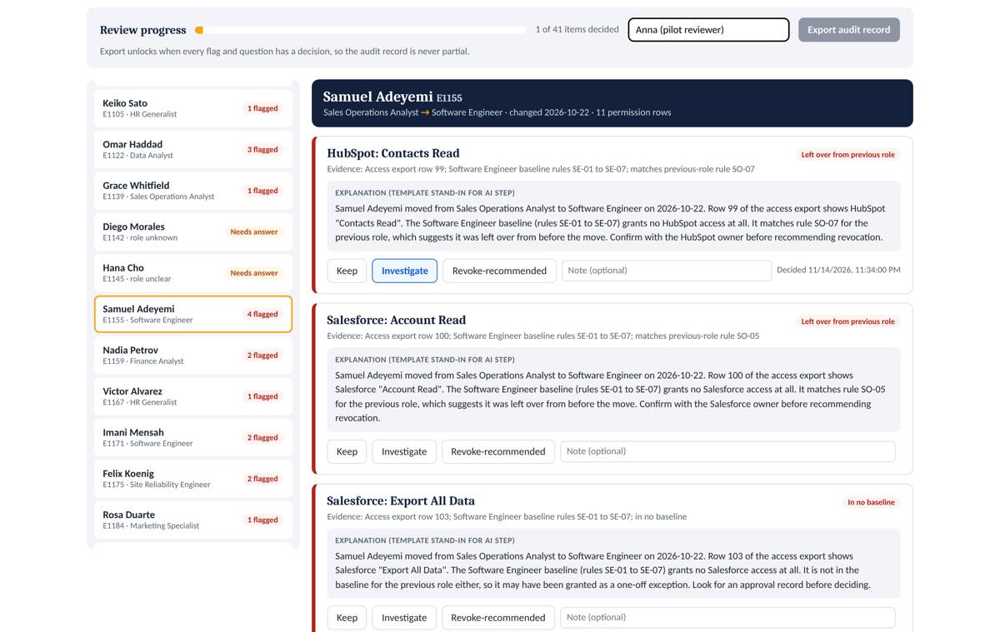
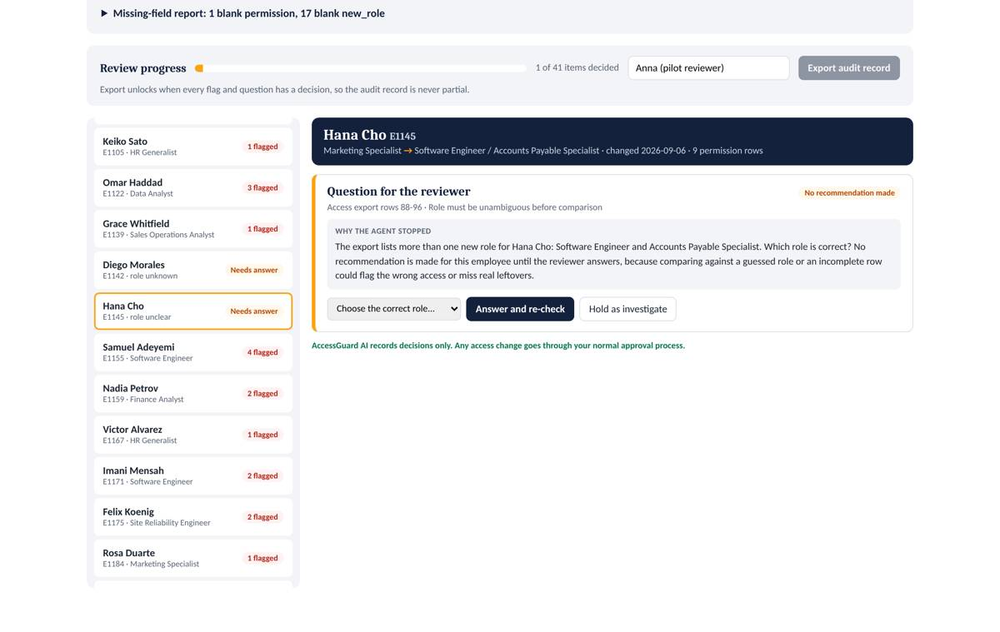

# AccessGuard AI: Release One Prototype

A working prototype of AccessGuard AI, a proposed assistant that helps identity and access management (IAM) administrators review an employee's access after a role change. It was built for an MSIS 524 (Managing IT Projects) team project at the University of Washington Foster School of Business.

**Try it:** open the live page (GitHub Pages link in the repository's About section), then click **Load synthetic test set**.



## The problem

When an employee moves to a new team, new access is usually added, but access from the old role is rarely removed. An administrator has to compare each person's current permissions with what the new role should have, chase down exceptions, decide what to keep, and document every decision for audit. Done by hand in spreadsheets, this is slow, and unneeded access can be missed.

## What the prototype does

The prototype takes two CSV files: an access export (one row per employee permission) and a role-permission baseline (what each role should have). It then works through three steps, each tied to a true-or-false claim from the project's Release One plan.

| Step | What happens | Claim |
|------|--------------|-------|
| **Detect** | Checks both files for missing columns and blank fields, then lists every permission that is outside the employee's new role. Each flag shows the source row, the baseline rules checked, and whether the permission is left over from the previous role or appears in no baseline at all. | 100% of planted mismatches found |
| **Clarify** | If a role is missing, two rows disagree on the new role, a role has no baseline, or a row is incomplete, the tool stops and asks the reviewer a question. It makes no recommendation for that employee until the question is answered. | 100% of planted data gaps end in a question |
| **Document** | The reviewer marks each flag keep, investigate, or revoke-recommended, with an optional note. Export unlocks only when every item has a decision, and the export records the decision, evidence, rule, reviewer, and timestamp. | 100% of decisions exported complete |

The tool never changes access. It has no connection to any identity system and makes no network calls. Everything runs in the browser.



## Test results

The test script runs the same engine the page uses against a synthetic test set with known answers.

| Claim | Planted | Result |
|-------|---------|--------|
| Detect | 35 permissions outside the new role; 18 rows with blank fields | 35 of 35 flagged, 0 false flags; 18 of 18 blank fields reported |
| Clarify | 2 missing roles, 2 conflicting roles, 1 role with no baseline, 1 blank permission row | 6 of 6 ended in a question, 0 recommendations; after the reviewer supplied the missing role, both employees were flagged exactly as expected |
| Document | Every item decided, then exported | 41 of 41 exported items complete |
| Safety | Search of the engine for network or write calls | None found |

Full output is in [`data/test_results.txt`](data/test_results.txt).

## Limits

- **The explanations are templates, not AI.** In the full product, a foundation model would write each explanation from the flagged rows and rules. Here, template text built from the same rows and rules stands in for that step. The rules, not the model, decide what gets flagged in both versions.
- **The data is synthetic.** Every employee, role, and permission was invented for testing, and the team wrote the answer key, so these results show the logic works as designed, not how it performs on real company exports.
- **One test run.** The project's pilot plan, not this prototype, is what would measure review time savings and explanation quality with real IAM administrators.

## Repository layout

```
index.html               The prototype (built file; served by GitHub Pages)
data/
  access_export.csv      Synthetic access export: 30 employees, 262 rows
  role_baseline.csv      Synthetic role baseline: 10 roles, 71 rules
  answer_key.json        The planted answer for each employee
  test_results.txt       Output of the claim tests
  sample_audit_export.csv  Example of the audit export
src/
  engine.js              Parsing, rules, clarification logic, and export
  app_template.html      Page layout and interface
  build.py               Builds index.html from the template, engine, and data
  make_data.py           Regenerates the synthetic test set (fixed seed)
  test_claims.js         Tests the three claims against the answer key
docs/                    Screenshots
```

## Running it yourself

Open `index.html` in any browser. To use your own files, upload an access export with the columns `employee_id, employee_name, previous_role, new_role, change_date, system, permission`, and a baseline with `role, system, permission, rule_id`.

To regenerate the data, rebuild the page, and rerun the tests (Python 3 and Node.js), run these from the repository root:

```
python3 src/make_data.py
python3 src/build.py
node src/test_claims.js
```
